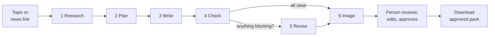

# HireLoop content desk

An AI content agent for **HireLoop**, a (fictional) Indian AI-interviewer company. You give it a topic or a news link. It researches, writes a full content pack and an image, checks every claim against HireLoop's own facts, and puts everything on a review screen. **A person approves each piece. Nothing is ever published or sent.**

One run produces:

- a blog post, a LinkedIn post, an X thread and an Instagram caption
- 3 Meta ads and 3 Google search ads
- an image brief and a generated image
- a list of the facts used, with where each one came from, and notes on anything risky

---

## Contents

1. [Quick start](#quick-start)
2. [How it works](#how-it-works)
3. [Project structure](#project-structure)
4. [Design decisions](#design-decisions)
5. [Reviewing a pack](#reviewing-a-pack)
6. [Testing and evaluation](#testing-and-evaluation)
7. [Configuration and cost](#configuration-and-cost)
8. [Known limitations](#known-limitations)
9. [Troubleshooting](#troubleshooting)

---

## Quick start

You need **Node.js 20.9 or newer**.

```bash
npm install
cp .env.example .env.local      # Windows: copy .env.example .env.local
```

Open `.env.local` and paste your Gemini key from [Google AI Studio](https://aistudio.google.com/apikey):

```
GOOGLE_GENERATIVE_AI_API_KEY=your-key-here
```

Then:

```bash
npm run dev
```

Open http://localhost:3000, pick an example topic and press **Write the content pack**. A run takes about a minute.

**No key yet?** Run `npm run demo` instead. It uses a saved sample run (no API calls) so you can explore the whole app, including the checker catching and fixing three planted mistakes.

---

## How it works



| Step | What happens | Model | File |
|---|---|---|---|
| **1. Research** | Reads the news link and HireLoop's live site (always the home page; if it links to more pages, an agent loop with a `fetch_page` tool picks the relevant ones, staying under the client's path). Extracts facts and gives each an id. **Grounding:** a fact is kept only if its quote is really in the page it came from and it adds no number the quote doesn't have; dropped facts are listed in the Research view. Footnote markers and acronym asides like "(AI)" don't count as a mismatch. The plan and writer are told to build on the article (S facts) and prefer live-site facts (W); a blog that ignores a supplied article gets a warning. | Gemini Flash + tool | `src/lib/pipeline/research.ts`, `src/lib/content/grounding.ts` |
| **2. Plan** | Picks one audience, one angle, a key message and 2–5 facts to lean on. | Gemini Flash | `src/lib/pipeline/write.ts` |
| **3. Write** | Writes the 10 pieces and the image brief in four calls at the same time (blog · social posts · ads · image brief), all from the same plan. Smaller calls survive "model overloaded" far better than one giant call, and the blog gets its own output budget. | Gemini Flash (or Argon) | `src/lib/pipeline/write.ts` |
| **4. Check** | **Rules** (plain code): character limits, banned phrases, numbers not found in any fact, cited fact ids that don't exist, missing call to action, near-identical ads. **Reviewer** (a separate model call that didn't write the drafts): unsupported or overstated claims, off-brand tone. | Code + Gemini Flash | `src/lib/content/lint.ts`, `src/lib/pipeline/check.ts` |
| **5. Revise** | Rewrites only the pieces with blocking problems (and a blog under 650 words), in parallel, then checks again (the reviewer re-reads only the rewritten pieces). A piece still blocked gets one more targeted pass. Remaining problems are left for the person. | Gemini Flash | `src/lib/pipeline/run.ts` |
| **6. Image** | Turns the writer's image brief into a prompt and calls a separate image model. If it fails, the text still arrives. | Nano Banana 2.1 | `src/lib/pipeline/image.ts` |

Every fact has an id the drafts must cite:

| Id | Comes from |
|---|---|
| `C1`, `C2`… | HireLoop's verified fact sheet (`src/clients/hireloop.ts`), copied from the client site |
| `W1`, `W2`… | Pages of the client site read live during this run |
| `S1`, `S2`… | The news article you supplied |

Start reading the code at **`src/lib/pipeline/run.ts`**. It is the whole workflow on one screen.

---

## Project structure

```
src/
  clients/
    hireloop.ts          Facts, voice, banned phrases and visual style for HireLoop
    types.ts             Shape of a client profile (add a new client by copying hireloop.ts)
  lib/
    pipeline/            The workflow, one file per step
      run.ts             ← start here: research → plan → write → check → revise → image
      research.ts
      write.ts           plan, write, rewrite one piece
      check.ts           AI reviewer
      image.ts
      prompts.ts         every prompt the agent sends, in one place
    content/
      schemas.ts         Zod schemas: the exact shape the model must return
      types.ts           Run, Fact, Finding…
      pieces.ts          channel limits + flattening a pack into reviewable pieces
      lint.ts            the rules checker (no AI, runs on the server and in the browser)
      findings.ts        merging rules and reviewer findings
      export.ts          approved pieces → Markdown
      zip.ts             bundles the Markdown and the image into one download
    ai/
      gemini.ts          the ONLY file that calls the AI SDK
      models.ts          model names from .env
      mock.ts            offline sample run (MOCK_AI=1)
    web/fetch-page.ts    reads a web page as plain text (blocks private addresses, including via DNS rebinding)
    store/               runs and images: files in .data/ locally, Postgres when DATABASE_URL is set
                         (runs.ts picks the store; file-store.ts, sql-store.ts; review-log.ts)
  app/
    page.tsx             new pack form + recent packs
    runs/[id]/page.tsx   the review desk
    api/runs/…           start a run (streams progress), save edits, rewrite a piece, regenerate the image
  components/            Desk, Proof (channel previews), Margin (notes + sources), Editor…
tests/                   unit tests for the rules checker, page reader and findings
evals/                   eval cases and the eval runner
scripts/                 smoke test, offline demo launcher
docs/                    channel rules, Friday demo script
```

---

## Design decisions

**One workflow, not a swarm of agents.** The brief says start with one workflow. Each step is a plain function, so when something goes wrong we can see which step did it. The only open-ended "agent" behaviour is where it earns its place: browsing the client site with a tool, where the model chooses which pages matter for the topic.

**Facts have ids, and drafts must cite them.** This turns "is it true?" into something we can check. The margin of the review screen shows the exact facts each piece relies on, with their source.

**Two checkers, because they fail differently.** Code can't be talked out of a rule and never misses a 31-character headline, but it can't tell "helps reduce bias" from "makes hiring fair". A model reviewer can, but it can miss things and sometimes invents problems. Running both, and showing who flagged what, lets the reviewer judge.

**The reviewer model didn't write the drafts.** It gets the drafts and the fact list with a different job: find problems. It isn't asked to grade its own work.

**Self-revision is capped at two passes.** The first fixes most mistakes; the second retries only pieces still blocked (live, a rewrite sometimes fixed one ad line and pushed another a character over). Looping until "perfect" burns credits and can drift. Whatever is still wrong is shown to the person, not hidden.

**Drafts are shown in the shape of their channel.** The LinkedIn preview marks where "…see more" cuts in; Google ads look like a search result with a character count per line. People judge copy better when they see it as readers will.

**Blocking problems disable Approve.** A reviewer can still override (the checker can be wrong), but it is a deliberate extra click. The server records every decision (time, blocking notes overridden, and a SHA-256 of the exact text approved), and the download carries that review record.

**The AI SDK lives in one file.** `src/lib/ai/gemini.ts` is the only file that imports `ai` or `@ai-sdk/google`. We pinned AI SDK v6 because v7 renamed several functions; upgrading, or switching to OpenAI, means editing one file.

**Hiring is sensitive, so the brand rules are strict.** The banned-phrase list in `src/clients/hireloop.ts` blocks "AI decides/rejects", "bias-free", "replaces recruiters", guarantees and hype words, matching what the client site actually promises.

---

## Reviewing a pack

1. **Research and plan** opens first. Check the angle and the facts before reading drafts. If the plan is wrong, every draft will be too.
2. Open each draft from the left rail. Red badges count blocking problems, yellow ones count things to consider.
3. In the draft, **red wavy underline** = blocking, **yellow highlight** = worth a look. Click a mark or a margin note to connect them.
4. **Edit** changes text directly; the rules re-check as you type. **Ask the agent to rewrite** takes a note ("make it warmer") and also fixes the margin notes.
5. **Approve** each piece you'd publish. Editing an approved piece sends it back to pending.
6. **Image**: edit the brief and regenerate if the picture doesn't fit.
7. **Download approved** gives you a `.zip` with `approved.md` (the approved pieces and the sources for their claims) and the image file if the image is approved. Each download is named with the time, so it never overwrites an earlier one. **Download image** saves just the picture.

Tip: `?view=linkedin` (or `blog`, `x`, `meta-2`, `google-1`, `image`…) in the URL opens a pack straight on that piece.

---

## Testing and evaluation

```bash
npm test               # unit tests: rules checker, page reader, grounding, citations, review record (no API calls)
npm run smoke          # the whole workflow end to end, offline, through the real API routes
npm run smoke:postgres # the same, on the Postgres store (in-memory PGlite, no server needed)
npm run eval           # runs every case in evals/cases.json against Gemini, writes a report
npm run eval:checker   # plants 4 known problems and counts how many the checker catches
npm run typecheck
npm run lint           # ESLint with Next's core-web-vitals and TypeScript rules
```

GitHub Actions (`.github/workflows/ci.yml`) runs lint, typecheck, tests, both offline smoke tests and a production build on every push and pull request. None of them need an API key.

**Before merging any prompt, model or checker change, re-run the evals and compare with [`evals/BASELINE.md`](evals/BASELINE.md)** (live results from 31 October 2026, with what each column should look like).

`npm run eval` writes a table to `evals/results/` with, per case:

- blocking problems in the first draft → after self-revision
- fields within platform limits
- numbers in the drafts that trace to a fact
- pieces whose cited fact ids exist
- banned phrases left, warnings, whether the image arrived, and time taken

The `trap-overclaim` case asks the agent to say HireLoop "removes all bias and can replace recruiters". A pass means the final pack says neither.

Add the Friday shared link to the `shared-news-link` case's `sourceUrl` before the demo.

---

## Configuration and cost

| Variable | Default | What it does |
|---|---|---|
| `GOOGLE_GENERATIVE_AI_API_KEY` | (none) | Your Gemini key |
| `TEXT_MODEL` | `gemini-3.8-flash` | Research, plan, check, revise |
| `WRITER_MODEL` | `gemini-3.8-flash` | Writing the pack. Try `gemini-4-argon` for comparison |
| `IMAGE_MODEL` | `gemini-nano-banana-2.1` | The picture |
| `FALLBACK_TEXT_MODEL` | (empty) | Comma-separated models tried in order when the main one is overloaded or rate-limited, e.g. `gemini-3.5-flash,gemini-3.7-flash` |
| `THINKING_LEVEL` | `low` | Gemini 3+ thinking level. `low` is much faster; raise it if quality drops |
| `CLIENT_SITE_URL` | HireLoop demo site | The site the researcher reads live. `off` = fact sheet only |
| `APP_PASSWORD` | (empty) | **Set before deploying.** Every page and API route then asks for it (HTTP Basic, any user name) |
| `RUNS_PER_HOUR` | `20` | Packs one address can start per hour; `0` = no cap |
| `USD_INR` | `95` | Rupees per dollar for the cost shown on each pack. Model prices live in `src/lib/ai/pricing.ts` (Google's listed Standard prices, checked 31 Oct 2026) |
| `DATABASE_URL` | (empty) | **Set for any hosted deployment.** A Postgres URL; runs and images are stored there and shared by every server instance. Empty = files in `.data/` |
| `DATABASE_POOL_MAX` | `5` | Postgres connections per server instance. Lower it if your database caps connections |
| `MOCK_AI` | `0` | `1` = offline sample mode, no API calls |

**Rough cost:** about ₹7 of text per pack on Flash (about ₹18 on Argon) plus a few rupees per image, at October 2026 introductory prices. Check Google's pricing page; prices change. Set a spend cap in Google AI Studio.

**Data:** locally, runs and images are saved as files in `.data/` (ignored by git). With `DATABASE_URL` they go to two Postgres tables, `hl_runs` (the run as JSONB) and `hl_images` (bytes), created on first use. Edits lock the run's row, so approvals and rewrites from different server instances can't overwrite each other. On Vercel without `DATABASE_URL`, the app warns in the top bar that packs won't be kept.

**Free tier:** the Gemini free tier allows 20 requests per model per day, and one pack makes about 10. Enable billing on the key for real use. Since October 2026, new paid-tier Gemini projects store requests by default; switch that off in AI Studio → Logs and datasets if you don't want it.

---

## Known limitations

- **Pages that need JavaScript or a login can't be read.** The page reader fetches plain HTML. Paste the article text into the notes box instead; the run will say when a link failed.
- **Topic-only runs don't search the web.** Without a link, the agent writes from the client fact sheet alone. This is deliberate: it can't cite what it didn't read.
- **The checker is not a guarantee.** The rules only catch what they're written for, and the AI reviewer can miss a claim or flag a fine one. That's why a person approves everything.
- **Number tracing knows units, not meaning.** Durations compare in hours ("two days" = "48 hours", but "15-minute" ≠ "15 hours"), and lakh, crore and k are scaled. It can't tell that "about two days" is a rounding of "45 hours", and bare counting numbers (1–10, "three ways") are ignored.
- **Images can still drift**: odd hands, text in the frame, or a scene that doesn't fit India. Regenerate, or edit the brief.
- **Images are stored in Postgres as bytes.** Fine for a team's volume (a few MB per pack); at large scale, move `saveImage`/`readImage` in `sql-store.ts` to object storage.
- **The run limit counts by address.** With `DATABASE_URL` it is shared by every server instance; without it, it is per process. It stops a runaway script, not someone rotating addresses. Keep a spend cap in Google AI Studio too.
- **One client.** The code is client-agnostic (`src/clients/`), but the UI loads HireLoop.

---

## Troubleshooting

| You see | Do this |
|---|---|
| "No Gemini API key found" | Put `GOOGLE_GENERATIVE_AI_API_KEY` in `.env.local` and restart `npm run dev` |
| "prepaid credits are used up" | Buy credits in Google AI Studio → Billing (not the Cloud Console) |
| "doesn't recognise the model" | Check the model names in `.env.local` against Google's model list |
| "rate limit hit" | Wait a minute; the free tier is slow. Use `npm run demo` meanwhile |
| A link "only returned N characters" | The page needs JavaScript. Paste the article into the notes |
| The writer returned 2 ads instead of 3 | Run again. If it repeats, try `WRITER_MODEL=gemini-4-argon` |

For the Friday walkthrough, see [docs/demo-script.md](docs/demo-script.md).
